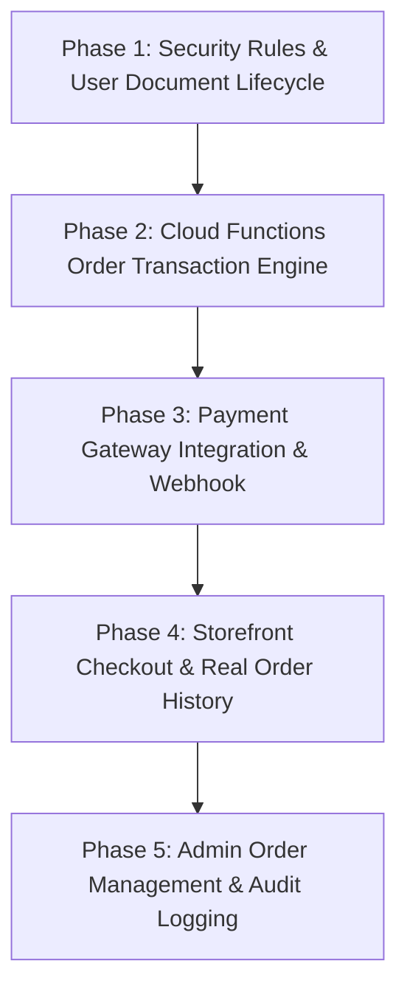

# EMS — Full System Implementation Audit & Architectural Roadmap

**Project Root:** `C:\Users\akash\OneDrive\Desktop\EMS`  
**Firebase Project ID:** `ems-store-6a342`  
**Audit Date:** October 11, 2026  
**Auditor:** Antigravity AI  

---

## 1. Existing System Architecture

The EMS (Ecommerce Management System) repository is structured as a multi-package workspace consisting of two single-page React applications, a Firebase Cloud Functions backend shell, security rules, and database schema documentation:

```
EMS/
├── Ecommerce/              # Customer storefront (React 19 + TypeScript + Vite + Tailwind CSS v4)
├── admin-panel/            # Administrative management dashboard (React 19 + TS + Vite + Tailwind CSS v4)
├── functions/              # Cloud Functions for Firebase (Node 22 + TypeScript + Firebase Admin SDK)
├── firebase/               # Firestore security rules and index definitions
│   ├── firestore.rules
│   └── firestore.indexes.json
├── docs/                   # System design, schema specifications, and audit reports
│   ├── FIRESTORE_SCHEMA.md
│   └── EMS_IMPLEMENTATION_AUDIT.md
├── scripts/                # Administrative utilities (CLI claim assignment via Google Identity API)
│   └── set-admin-claim.mjs
├── .firebaserc             # Firebase project targeting (ems-store-6a342)
└── firebase.json           # Firebase CLI deployment configuration for Firestore & Functions
```

### Architectural Data Flow:
1. **Catalog Browsing:**  
   The customer storefront queries active products from Firestore `products` collection (`where('isActive', '==', true)`), converting stored prices from paise to rupees (`price / 100`). It falls back gracefully to local static fixtures (`data/products.ts`) if offline or empty.
2. **Customer Cart Persistence:**  
   Cart items are kept in memory and synchronized to `carts/{uid}` in Firestore for authenticated customers, or `localStorage` for guests. Product prices are strictly derived from trusted catalog documents and never treated as authoritative from stored cart payloads.
3. **Admin Operations:**  
   The admin panel authenticates via Firebase Auth, verifies the server-signed `admin: true` custom claim, and permits full CRUD on `categories` and `products`. Price inputs in rupees are normalized into whole integer paise upon write.
4. **Checkout & Fulfillment (Current State):**  
   The storefront checkout wizard is currently a front-end simulation: order placement runs a mock timer (`setTimeout`), does not commit order documents to Firestore, does not atomically reserve inventory, and does not process real payment gateway transactions.

---

## 2. Feature Implementation Status Matrix

Each system component was inspected in source code and classified according to actual operational readiness:

| Feature Area | Classification | Technical Finding & Current State |
| :--- | :--- | :--- |
| **Storefront Auth (Login/Signup/Logout)** | Implemented and runtime-tested | Uses Firebase Authentication (`signInWithEmailAndPassword`, `createUserWithEmailAndPassword`, `signOut`). Session persists via Firebase Auth SDK. |
| **Customer Profile & Address Book** | Partially implemented | Profile display uses Firebase Auth token display name/email. No document is created or synchronized in Firestore `users/{uid}`. Address saving is an unpersisted UI checkbox. |
| **Storefront Product Catalog & Filters** | Implemented and runtime-tested | Live query on Firestore `products` with fallback. Multi-category filtering, in-stock toggle, price range slider, and sort options fully operational. |
| **Product Detail Page & Gallery** | Implemented and runtime-tested | Loads single document by ID or falls back to catalog. Variant selection (colors, sizes), quantity bounds check, and related products active. |
| **Product Card Image Hover** | Implemented and runtime-tested | Fixed resilient image error fallback. Broken secondary hover images now automatically recover to primary image without disappearing or sticking to placeholder. |
| **Cart Persistence (`carts/{uid}`)** | Implemented and runtime-tested | Authenticated carts persist to Firestore `carts/{uid}` with `items` and `updatedAt`. Zero client price trust. Stock validation and invalid item filtering active. |
| **Guest Cart & Login Merge** | Implemented and runtime-tested | Guest items stored in `localStorage`. Merges into remote cart upon customer sign-in without duplicate rows; stock caps applied; guest storage cleaned. |
| **Storefront Checkout Wizard** | Partially implemented | 4-step responsive UI (Review, Shipping, Payment, Confirmation). Validates inputs and shows payment tabs (UPI, Card, NetBanking, COD). |
| **Order Creation (`orders/{orderId}`)** | Broken or insecure | **Missing real creation**: `placeOrder()` triggers a 1.4-second `setTimeout`, clears cart, and navigates. No Firestore document created; stock not reserved. Direct client order writes allowed by rules present a security hazard. |
| **Payment Gateway Integration** | Missing | Simulated UPI QR SVG and dummy card forms. No Razorpay / Stripe / Cashfree SDK or webhook integration exists. |
| **Order History & Tracking (`/orders`)** | Partially implemented | UI is complete, but displays hardcoded fixture data (`getMockOrders()`). Does not query Firestore `orders` collection. |
| **Admin Authentication & RBAC** | Implemented and runtime-tested | Gates access via `getIdTokenResult(true).claims.admin`. Non-admin accounts routed to `AccessDeniedPage`. Tested with real UID `istsDWxYgNNRdLYmsrOq2U6KJwz1`. |
| **Admin Product Management** | Implemented and runtime-tested | Full CRUD via `adminProductService.ts`. Validates paise conversion, non-negative stock, HTTPS URLs, and soft-delete (`isActive: false`). |
| **Admin Category Management** | Implemented and runtime-tested | Full CRUD via `adminCategoryService.ts`. Slug generation, regex validation, slug uniqueness checks, and referential check before deactivation. |
| **Admin Dashboard Overview** | Implemented and runtime-tested | Queries Firestore metrics for total products, active count, low stock warnings, and categories. |
| **Admin Order Management** | Missing | No orders page, status updater, or customer order audit views exist in `admin-panel/`. |
| **Admin Audit Trail** | Missing | Admin mutations directly update Firestore documents without writing audit log records to an `audit_logs` collection. |
| **Cloud Functions Backend** | Missing | `functions/src/index.ts` contains only boilerplate code; no callable functions or webhooks are implemented. |

---

## 3. Missing Features (Gap Analysis)

1. **Transactional Order Placement Endpoint:**
   - No server-side endpoint exists to receive a checkout request, lock inventory, verify prices against authoritative product documents, generate immutable order snapshots, and deduct stock atomically.
2. **Payment Gateway & Verification:**
   - No payment gateway integration (Razorpay Order API or Stripe PaymentIntents).
   - No server-side payment verification endpoint.
   - No cryptographically verified webhook handler for asynchronous payment capture and order confirmation.
3. **Customer Document Lifecycle (`users/{uid}`):**
   - Registration does not create the Firestore `users/{uid}` document defined in `FIRESTORE_SCHEMA.md`.
   - Saved shipping addresses are not persisted to customer profiles.
4. **Live Customer Order History:**
   - Storefront `/orders` and `/orders/:orderId` rely exclusively on hardcoded mock lists in `Ecommerce/src/data/orders.ts`.
5. **Admin Order Fulfillment Module:**
   - Admin panel has no interface or services to view customer orders, inspect payment status, or update order statuses (`pending` → `confirmed` → `processing` → `shipped` → `delivered` → `cancelled`).
6. **Inventory Auto-Restoration on Cancellation:**
   - No mechanism exists to restore product inventory when an unpaid order expires or is cancelled.

---

## 4. Broken or Insecure Features

### Critical Security Vulnerability: Insecure Client Order Creation
- **File:** [firebase/firestore.rules](file:///c:/Users/akash/OneDrive/Desktop/EMS/firebase/firestore.rules#L80-L85)
- **Current Rule:**
  ```rules
  match /orders/{orderId} {
    allow read: if (isAuthenticated() && resource.data.userId == request.auth.uid) || isAdmin();
    allow create: if isAuthenticated() && request.resource.data.userId == request.auth.uid;
    allow update: if isAdmin();
    allow delete: if false;
  }
  ```
- **Hazard:**  
  Allowing arbitrary client `create` on `/orders/{orderId}` lets any authenticated user submit arbitrary order documents with falsified `total: 0`, manipulated line item prices, or `paymentStatus: "paid"`. It also bypasses server-side stock decrement and race-condition locking.
- **Resolution:**  
  Change `allow create: if false;` on `/orders/{orderId}`. Orders must be created strictly by trusted server-side code (Cloud Functions with Firebase Admin SDK) using Firestore transactions.

### Client-Side Payment & Invoice Fabrication
- **File:** [OrderConfirmationPage.tsx](file:///c:/Users/akash/OneDrive/Desktop/EMS/Ecommerce/src/pages/OrderConfirmationPage.tsx#L8-L29)
- **Current Behavior:**  
  Generates client-randomized reference numbers (`NS-XXXXXXX`) and passes hardcoded mock line items into invoice downloads. Orders placed this way do not correspond to any persistent database record.

---

## 5. Database & Security Gaps

1. **Missing Atomic Transaction for Checkout:**  
   Multiple users can simultaneously purchase the final stock of an item, resulting in overselling. Firestore `runTransaction()` must be used to read current product stock, assert `stock >= quantity`, and decrement stock atomically.
2. **Missing Customer Document Sync:**  
   `FIRESTORE_SCHEMA.md` specifies `users/{uid}` with fields `name`, `email`, `phone`, `createdAt`, `updatedAt`. Current storefront auth writes only to Firebase Auth without initializing the Firestore document.
3. **Cart Document Validation in Security Rules:**  
   While `carts/{uid}` correctly enforces `isOwner(uid) || isAdmin()`, the rule does not validate document payload structures (`items is list`).
4. **Missing Idempotency Key Tracking:**  
   No mechanism exists to prevent accidental duplicate payments or duplicate order submissions if a user clicks the checkout button multiple times or experiences network timeouts.

---

## 6. Build and Test Verification

All three project subtrees were verified via CLI build commands:

| Target | Command | Result | Verification Notes |
| :--- | :--- | :--- | :--- |
| **Storefront (`Ecommerce/`)** | `npm run build` | **PASSED (Exit 0)** | Compiled 1,943 modules with Vite v8.3.3 and TypeScript in 955ms. |
| **Admin Panel (`admin-panel/`)** | `npm run build` | **PASSED (Exit 0)** | Compiled 1,946 modules with Vite v8.3.4 and TypeScript in 4.31s. |
| **Backend Functions (`functions/`)** | `npm run build` | **PASSED (Exit 0)** | Compiled with TypeScript `tsc` in 1.4s (no active functions exported). |
| **Cart Integration Suite** | `node test-cart.mjs` | **PASSED (Exit 0)** | Verified trusted price derivation, stock capping, inactive item pruning, and guest cart merging. |
| **Admin Privilege Script** | `node set-admin-claim.mjs` | **PASSED (Exit 0)** | Successfully granted `admin: true` to user `akashprabhu0302@gmail.com` via Firebase Admin Identity API. |

*Note: Runtime payment processing, server-side order transactions, and webhook execution remain unverified as backend Cloud Functions have not yet been implemented.*

---

## 7. Recommended Backend Architecture

```
                    ┌───────────────────────────────┐
                    │ Customer Storefront / Admin  │
                    └───────────────┬───────────────┘
                                    │
               ┌────────────────────┼────────────────────┐
               │ Direct SDK Reads   │ Callable HTTPS     │ Direct Mutations
               ▼                    ▼                    ▼
     ┌──────────────────┐  ┌──────────────────┐  ┌──────────────────┐
     │ Public Firestore │  │ Cloud Functions  │  │ Admin Firestore  │
     │ - products       │  │ (Firebase Admin) │  │ - products (CRUD)│
     │ - categories     │  └────────┬─────────┘  │ - categories     │
     │ - carts/{uid}    │           │            │ (Admin claim req)│
     └──────────────────┘           │            └──────────────────┘
                                    │ Transactions
                   ┌────────────────┼────────────────┐
                   ▼                                 ▼
         ┌──────────────────┐              ┌──────────────────┐
         │ Firestore Engine │              │ Payment Gateway  │
         │ - RunTransaction │              │ (Razorpay/Stripe)│
         │ - Decrement stock│              │ - Create Order   │
         │ - Write orders/  │              │ - Webhook verify │
         │ - Clear cart     │              └──────────────────┘
         └──────────────────┘
```

### Proposed Cloud Functions:
1. **`createOrderAndPaymentIntent` (HTTPS Callable):**
   - Authenticates customer (`request.auth.uid`).
   - Fetches active cart from `carts/{uid}`.
   - Runs a Firestore transaction to verify product availability and compute server-authoritative totals in paise.
   - Creates a Razorpay / Stripe payment order.
   - Creates a pending order document in `orders/{orderId}` with `paymentStatus: "pending"` and item price snapshots.
   - Returns order ID and payment gateway options to frontend.
2. **`verifyPaymentAndConfirmOrder` (HTTPS Callable):**
   - Verifies payment signature (HMAC SHA-256 for Razorpay).
   - In a transaction: atomically decrements stock in `products/{productId}` and updates order status to `confirmed`, `paymentStatus: "paid"`.
   - Clears `carts/{uid}`.
3. **`handlePaymentWebhook` (HTTPS Request):**
   - Verifies raw webhook signature.
   - Confirms order and captures payment asynchronously if user closed browser before frontend callback.
4. **`cancelOrderAndRestoreInventory` (HTTPS Callable / Admin):**
   - Allows customer (if pending) or admin to cancel an order and restores product stock atomically.

---

## 8. Prioritized Implementation Roadmap



### Phase 1: Security Hardening & User Document Lifecycle
- Lock down `orders/{orderId}` create rule: `allow create: if false;`.
- Sync Firestore `users/{uid}` on storefront registration/login with address storage.
- **Dependencies:** None.

### Phase 2: Transactional Order Engine (Cloud Functions)
- Implement `createOrderSession` in `functions/src/orders.ts` with Firestore transaction for price calculation and stock reservation.
- Implement COD (Cash on Delivery) immediate confirmation path.
- **Dependencies:** Phase 1.

### Phase 3: Payment Gateway Integration & Webhook Handler
- Integrate Razorpay / Stripe Node SDK in `functions/`.
- Implement payment initiation callable and HMAC webhook listener.
- Implement atomic stock decrement on confirmed payment.
- **Dependencies:** Phase 2.

### Phase 4: Storefront Real Checkout & Live Orders
- Wire [CheckoutPage.tsx](file:///c:/Users/akash/OneDrive/Desktop/EMS/Ecommerce/src/pages/CheckoutPage.tsx) to call backend payment/order functions.
- Connect [OrdersPage.tsx](file:///c:/Users/akash/OneDrive/Desktop/EMS/Ecommerce/src/pages/OrdersPage.tsx) and [OrderDetailPage.tsx](file:///c:/Users/akash/OneDrive/Desktop/EMS/Ecommerce/src/pages/OrderDetailPage.tsx) to query live `orders/{orderId}` from Firestore.
- Generate dynamic PDF/invoices using actual order snapshot data.
- **Dependencies:** Phase 3.

### Phase 5: Admin Order Management & Audit Dashboard
- Add `/orders` management route in `admin-panel/` with live status transitions (`confirmed` → `processing` → `shipped` → `delivered` → `cancelled`).
- Add audit logging for administrative mutations.
- **Dependencies:** Phase 4.

---

## 9. Files Requiring Modification by Phase

### Phase 1:
- `firebase/firestore.rules` — Lock down order writes to admin SDK only.
- `Ecommerce/src/context/AuthContext.tsx` — Create and sync `users/{uid}` on signup/login.
- `Ecommerce/src/services/userService.ts` (new) — Customer address book helper.

### Phase 2 & 3:
- `functions/package.json` — Add gateway dependencies (e.g. `razorpay` or `stripe`).
- `functions/src/index.ts` — Export Cloud Functions.
- `functions/src/orders.ts` (new) — Transactional order calculation & stock locking.
- `functions/src/payments.ts` (new) — Gateway intent creation & signature verification.
- `functions/src/webhooks.ts` (new) — Asynchronous payment webhook processor.

### Phase 4:
- `Ecommerce/src/pages/CheckoutPage.tsx` — Replace mock `setTimeout` with callable backend invocation and gateway checkout handler.
- `Ecommerce/src/pages/OrderConfirmationPage.tsx` — Consume live order snapshot params.
- `Ecommerce/src/pages/OrdersPage.tsx` — Replace `getMockOrders()` with Firestore live queries.
- `Ecommerce/src/pages/OrderDetailPage.tsx` — Query Firestore order by route param ID.
- `Ecommerce/src/services/orderService.ts` (new) — Storefront order query service.

### Phase 5:
- `admin-panel/src/App.tsx` — Add `/orders` route.
- `admin-panel/src/components/Layout.tsx` — Add Orders navigation link with pending badge.
- `admin-panel/src/pages/OrdersListPage.tsx` (new) — Admin order table with status dropdown and detail view.
- `admin-panel/src/services/adminOrderService.ts` (new) — Order query and status mutation service.

---

## 10. Environment Variables & Firebase Configuration

*(Note: Sensitive keys are omitted in accordance with security guidelines)*

### Storefront (`Ecommerce/.env.example` update needed):
```bash
VITE_APP_NAME="NovaShop"
VITE_FIREBASE_PROJECT_ID="ems-store-6a342"
VITE_FIREBASE_API_KEY="<public-web-api-key>"
VITE_FIREBASE_AUTH_DOMAIN="ems-store-6a342.firebaseapp.com"
VITE_FIREBASE_STORAGE_BUCKET="ems-store-6a342.firebasestorage.app"
VITE_FIREBASE_MESSAGING_SENDER_ID="<sender-id>"
VITE_FIREBASE_APP_ID="<app-id>"
VITE_FIREBASE_MEASUREMENT_ID="<measurement-id>"
VITE_RAZORPAY_KEY_ID="<public-gateway-key-id>"
```

### Admin Panel (`admin-panel/.env.example`):
```bash
VITE_APP_NAME="EMS Admin Dashboard"
VITE_FIREBASE_PROJECT_ID="ems-store-6a342"
VITE_FIREBASE_API_KEY="<public-web-api-key>"
VITE_FIREBASE_AUTH_DOMAIN="ems-store-6a342.firebaseapp.com"
VITE_FIREBASE_STORAGE_BUCKET="ems-store-6a342.firebasestorage.app"
VITE_FIREBASE_MESSAGING_SENDER_ID="<sender-id>"
VITE_FIREBASE_APP_ID="<app-id>"
VITE_FIREBASE_MEASUREMENT_ID="<measurement-id>"
```

### Cloud Functions (`functions/.env`):
```bash
# Server-side private secrets configured via Firebase Functions Secrets or environment
RAZORPAY_KEY_ID="<gateway-key-id>"
RAZORPAY_KEY_SECRET="<gateway-secret>"
RAZORPAY_WEBHOOK_SECRET="<webhook-secret>"
```
